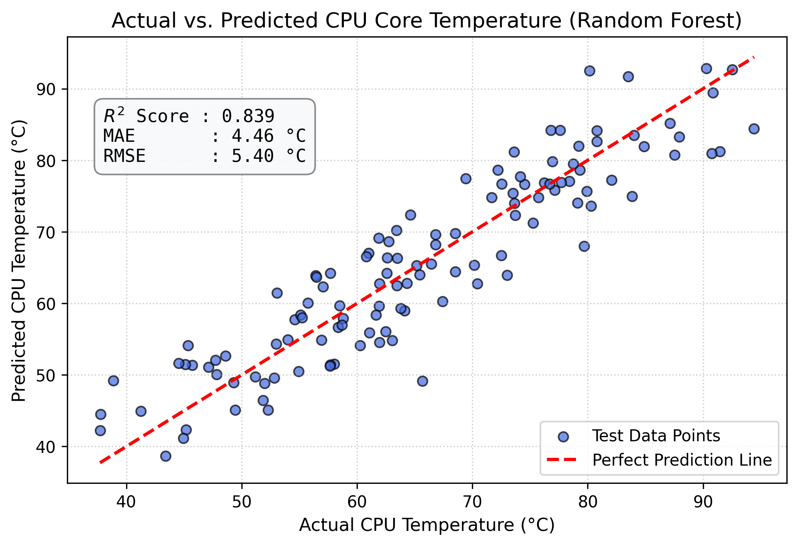

# Embedded CPU Thermal & Overheat Prediction API

A containerized machine learning microservice built with **Scikit-Learn**, **FastAPI**, and **Docker** that predicts microprocessor core temperature (°C) from ambient temperature and CPU workload telemetry, issuing real-time overheating alerts when core temperature exceeds `75.0 °C`.

## Model Performance


- **Algorithm:** Random Forest Regressor (`n_estimators=100`)
- **R² Score:** `0.839`
- **Mean Absolute Error (MAE):** `4.46 °C`
- **Root Mean Squared Error (RMSE):** `5.40 °C`

## How to Run Locally
1. Install dependencies:
   ```bash
   pip install -r requirements.txt
